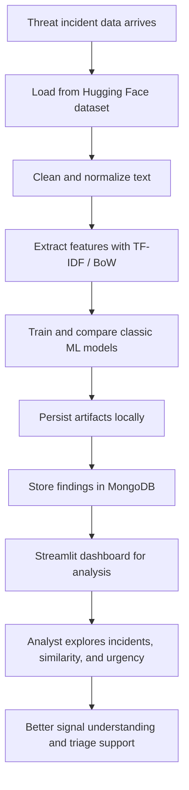
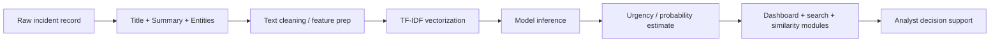
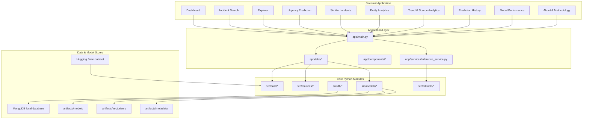

# CyberThreat Intelligence AI

<p align="center">
  
  
  
  
  
  
</p>

<p align="center">
  <strong>Mission:</strong> turn noisy cyber-incident signals into a readable, searchable, model-assisted intelligence story.
</p>

> “The battlefield is loud. Threats arrive as fragments of titles, summaries, entities, and sources. This project listens, clusters, and helps defenders make sense of the chaos.”

## The Story

CyberThreat Intelligence AI is a defensive, educational cyber-threat intelligence dashboard built to explore and reason about incident data through classic machine learning and NLP workflows. It does not claim to replace human analysts or real-world threat scoring systems. Instead, it acts like a tactical assistant in the command room: it ingests threat incident records, normalizes messy text, compares similarity, predicts urgency patterns, and gives defenders a structured lens for investigation.

This project blends:

- threat intelligence exploration
- incident search and filtering
- entity-based analysis
- similar incident discovery
- urgency prediction
- trend/source intelligence
- model evaluation and experiment tracking

The result is a single Streamlit application that feels like a command center for defenders who need to understand patterns without drowning in raw signals.

---

## Why this project exists

Modern cyber threat reporting is noisy. A single incident can appear across multiple fields:

- attack titles
- narrative summaries
- device or network entities
- source attribution
- severity and confidence hints

The problem is not lack of data. It is signal overload. This project helps simplify that complexity by converting textual risk data into searchable, comparable, and explainable intelligence artifacts.

It is designed for:

- analysts exploring security incident clusters
- defenders tracking emerging patterns
- researchers comparing model behavior
- teams learning how classical ML/NLP can support cyber intelligence workflows

---

## What the system does

### Core capabilities

| Capability | What it does | Why it matters |
|---|---|---|
| Incident Search | Query and filter threat reports | Finds the right clue quickly |
| Incident Explorer | Browse the dataset and structures | Makes patterns visible |
| Urgency Prediction | Predict urgency labels from text | Prioritizes likely impact |
| Similar Incidents | Find related reports by content similarity | Surfaces clusters and connections |
| Entity Analytics | Analyze names, actors, targets, and keywords | Reveals recurring entities |
| Trend & Source Analytics | Track sources and trends over time | Supports signal monitoring |
| Prediction History | Review model outputs over time | Helps compare reasoning |
| Model Performance | Evaluate classic ML approaches | Shows what works best |
| About & Methodology | Document dataset and constraints | Keeps the system honest |

---

## The mission flow



---

## Data-to-decision flow



---

## Architecture snapshot



---

## The intelligence stack

This project is built with a human-centered AI + analytics workflow, using well-known Python tools for data science and interactive exploration.

### Technology stack

- Python 3.10+
- Streamlit for the interactive interface
- Pandas and NumPy for data handling
- scikit-learn for classic ML and NLP pipelines
- Hugging Face `datasets` library for dataset access
- PyMongo for local MongoDB interaction
- Plotly, Matplotlib, and Seaborn for visual analysis
- Jupyter for research exploration

### Model philosophy

The project evaluates several classic machine learning approaches rather than relying on a single model. The workflow includes model families such as:

- Logistic Regression + TF-IDF
- Linear SVC + TF-IDF
- Multinomial Naive Bayes + TF-IDF
- Random Forest + TF-IDF
- HistGradientBoosting + TF-IDF
- K-Nearest Neighbors + TF-IDF
- Logistic Regression + CountVectorizer (Bag-of-Words)

This comparison supports transparent experimentation and helps determine which model behaves best for the dataset and the task.

---

## The dataset story

The project loads its incident data from the ThreatCluster dataset on Hugging Face using the official `datasets` library. It is intentionally designed to avoid static CSV or locked-in local copies in the project repository.

### Included signal types

The dataset is centered around cyber-incident records and commonly includes fields such as:

- `cluster_id`
- `title`
- `summary`
- `urgency_level`
- `threat_score`
- `severity_score`
- `credibility_score`
- `keywords`
- `entities`
- `sources`
- `first_reported`
- `last_reported`

> This project is for defensive education and analysis. It is not a live threat scoring engine or a validated real-world incident severity authority.

---

## Install and run

### 1) Clone the repository

```bash
git clone https://github.com/ArshiBansal/cyberthreat_intelligence_ai.git
cd cyberthreat_intelligence_ai
```

### 2) Create a virtual environment

```bash
python -m venv .venv
source .venv/bin/activate
```

On Windows:

```powershell
python -m venv .venv
.\.venv\Scripts\Activate.ps1
```

### 3) Install dependencies

```bash
pip install -r requirements.txt
```

### 4) Start MongoDB locally

This application expects a local MongoDB Community Server running on:

```text
mongodb://localhost:27017
```

Make sure your local database is reachable before using the app.

### 5) Launch the app

```bash
streamlit run app/main.py
```

Then open the local Streamlit URL in your browser.

---

## Project structure

```text
cyberthreat_intelligence_ai/
├── app/
│   ├── components/
│   ├── services/
│   ├── tabs/
│   └── main.py
├── artifacts/
│   ├── metadata/
│   ├── models/
│   └── vectorizers/
├── config/
│   └── settings.py
├── data/
├── notebooks/
├── scripts/
├── src/
│   ├── artifacts/
│   ├── data/
│   ├── db/
│   ├── features/
│   ├── models/
│   └── utils/
├── LICENSE
├── README.md
├── requirements.txt
└── .env.example (if present in your environment)
```

---

## Environment settings

The app centralizes configuration under `config/settings.py`.

Key defaults include:

- `MONGO_URI = mongodb://localhost:27017`
- `MONGO_DB_NAME = cyberthreat_intelligence_ai`
- dataset source = `threatcluster/threat-incident-clusters`
- artifact directories under `artifacts/`

You can override values using a `.env` file at the project root.

Example:

```env
APP_ENV=development
MONGO_URI=mongodb://localhost:27017
MONGO_DB_NAME=cyberthreat_intelligence_ai
ARTIFACTS_DIR=artifacts
LOG_LEVEL=INFO
```

---

## Workflow in plain English

1. The system loads a threat dataset from Hugging Face.
2. Text fields are cleaned and converted into model-readable features.
3. Classic supervised models are trained and compared.
4. The best-performing model is saved with metadata and vectorizer artifacts.
5. The app loads those artifacts and serves predictions through Streamlit.
6. Analysts search, compare, score, and review the intelligence story in one place.

---

## Safety and responsible use

This project exists for defensive, educational, and research-oriented use. It should be treated as a support tool, not as an autonomous judgment engine.

### Guardrails

- do not use the project for real-time operational severity enforcement
- do not treat predictions as verified threat truth
- do not use it to launch attacks, exploit systems, or gather credentials
- validate output before acting on intelligence artifacts
- respect dataset licensing and attribution requirements

> Security software should make defenders sharper, not careless.

---

## Roadmap

The project has strong room for growth, including:

- richer temporal analytics and forecasting
- deeper entity extraction and correlation
- stronger alert prioritization heuristics
- model experiment tracking dashboards
- additional dataset integrations and benchmarking
- API exposure for external analyst tooling

---

## Project status

<p align="center">
  
  
  
</p>

---

## License

This project is licensed under the MIT License. See [LICENSE](LICENSE) for details.

---

## Final note

CyberThreat Intelligence AI is a story of turning fragmented threat signals into a meaningful intelligence narrative. It is built for curiosity, learning, and defensive analysis — a reconnaissance partner for the modern analyst searching for patterns in the noise.

If you are exploring the repo, start with:

- `app/main.py` for the interface entry point
- `config/settings.py` for configuration
- `src/data/loader.py` for dataset loading
- `src/models/trainers.py` for the modeling flow
- `app/services/inference_service.py` for inference and prediction logic

The signal is out there. This project helps you listen.
